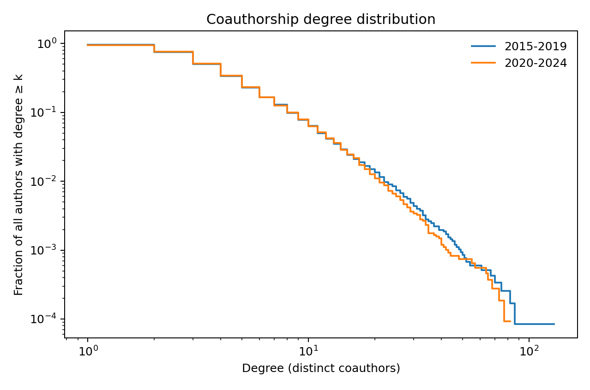

# Physics coauthorship among Iran-affiliated authors, 2015–2024

Five-year undirected graphs join pairs of authors whose own authorships list an Iranian institution on the same article. Edge weights count shared articles. The primary analysis allows up to 50 total listed authors per article.

| Measure | 2015–2019 | 2020–2024 |
|---|---:|---:|
| Articles retrieved | 13,583 | 12,007 |
| Articles included | 12,754 | 11,321 |
| Distinct authors | 11,777 | 10,838 |
| Distinct coauthor pairs | 21,805 | 20,004 |
| Mean degree | 3.7030 | 3.6915 |
| Fraction in largest component | 0.5676 | 0.5284 |
| Fraction of pairs with ≥2 articles | 0.2245 | 0.2119 |
| Mean local clustering | 0.6015 | 0.6123 |
| Transitivity | 0.3260 | 0.3911 |
| Communities on the largest component | 65 | 60 |
| Weighted modularity on the largest component | 0.9180 | 0.9292 |

## Interpretation

The corpus comprises OpenAlex articles with primary field 31, Physics and Astronomy, and an institution in Iran. Coverage depends on topic assignment, institutional identification and author disambiguation. Authors with zero eligible neighbors remain in the graph. Unresolved author IDs and incomplete author lists are excluded under the rules in the README.

See `team_size_sensitivity.csv` for thresholds of 20, 50 and 100 total listed authors. Community labels are local to each period. Louvain modularity is descriptive. Comparing its two values cannot establish a statistically significant change in community structure.
